<div align="center">

<picture>
  <source media="(prefers-color-scheme: dark)" srcset="docs/assets/brand/kadaos-banner-dark.svg">
  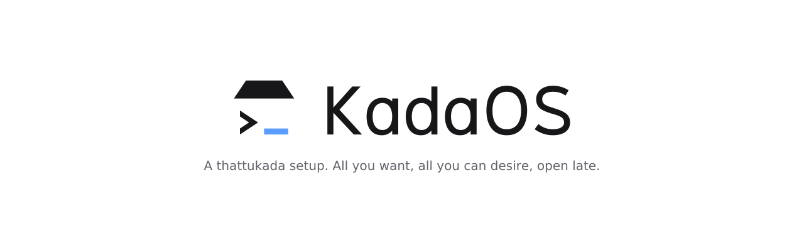
</picture>

**An Ubuntu + Hyprland workstation that serves everything from one counter.**<br>
A calm desktop, a local AI assistant, a security workbench, developer tools, your Pis and your phone,<br>
and one search box that reaches all of it. Installed with one command.

[](LICENSE)
[](#before-you-order)
[](https://hypr.land)
[](#pazhampori-the-local-ai-layer)
[](docs/TESTING.md)

[Install](#one-command-install) · [The menu](#whats-on-the-menu) · [Super + Space](#one-shortcut-super--space) · [Guides](docs/INDEX.md) · [Adapt it](docs/ADAPTING.md) · [FAQ](#faq)

</div>

---

A *thattukada* is the roadside tea stall you find all over Kerala: a small counter, open late, that somehow serves
everything from a glass of tea to a full meal, fast, to whoever walks up. KadaOS is that, for a Linux workstation.
It started as one developer's daily setup (a laptop that does web development, embedded work, security research and
runs several AI agents at once) and grew into something anyone can install, take apart and make their own.

It's opinionated where it saves you time and switchable everywhere else: every feature has an off switch, every
setting lives in a file you can edit, and nothing leaves your machine unless you send it.

## One command install

```sh
git clone https://github.com/MuhammadRamzy/KadaOS ~/KadaOS
cd ~/KadaOS && ./kada
```

`./kada` opens the menu below. Pick an order, or go à la carte; it shows what each dish costs (disk, time) before anything
runs, asks for your password once, and tells you what it served. Unattended: `./kada --order chaya-kadi --yes`.

<details>
<summary><b>What the installer does (and doesn't)</b></summary>

- Runs plain, readable scripts from [`scripts/`](scripts). Each one is safe to run again: it skips what's installed,
  backs up any config it replaces (to `~/.config/setup-backups/`), and logs to `setup.log`.
- Uses official sources only: Ubuntu's archive, vendor apt repositories (Docker, VS Code, Antigravity…), and each tool's
  own official installer where that's the vendor's supported way (uv, rustup, fnm and bun install into your home folder;
  Ollama's script installs its service). Read [`scripts/`](scripts) before you run it; it's meant to be read.
- Detects your hardware instead of assuming it: hybrid Intel + NVIDIA graphics, refresh rates, batteries, Wi-Fi cards.
- Never uploads anything. The assistant, dictation, OCR and search run on your machine.
- `./kada --dry-run --order sadhya` shows exactly which scripts would run.

</details>

## What's on the menu

| Order | You get |
|---|---|
| ☕ **Chaya** | Just tea: the Hyprland desktop, the Graphite theme, the bar, Super + Space and the native panels. The light start. |
| 🍪 **Chaya & Kadi** | Tea and a snack: Chaya plus a password vault, a leak scan before every commit, and network trust levels. |
| 🖤 **Kattan Chaya** | Strong black tea: the security workbench (60+ tools, scoped recipes, reports, an isolated lab network). |
| 🫓 **Porotta Special** | The developer kit (Python, Node, Rust, Go, Java, VS Code, Docker) and the coding agents with a task board. |
| 🍌 **Pazhampori** | The crowd favourite: the local AI layer. An assistant, dictation, OCR and search by meaning, all on-device. |
| 🍳 **Omelette, made to order** | Remote devices and embedded boards over SSH and serial, plus the phone link. |
| 🍛 **Full Sadhya** | The feast: everything above, plus ROS 2 for robotics. |

À la carte: `./kada --items desktop,dev,ai` (what a dish needs is added for you). The whole board: `./kada --list`.

## One shortcut: Super + Space

<table>
<tr>
<td width="55%">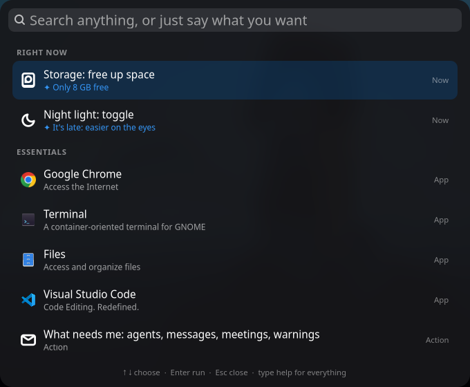</td>
<td>

Hundreds of shortcuts are no use if you have to remember them. In KadaOS you remember one.
Press **Super + Space** and type what you want:

- **an app, a feature, a setting, a file, a project**: it opens
- **plain words**: *"make the screen dimmer"*, *"I'm about to give a talk"*. The local AI understands and suggests the action (it never runs anything without your Enter)
- **commands with values**: `volume 30`, `timer 10 min tea`, `remind me at 6:30 pm to call home`, `kill 3000`
- **anything else**: Enter searches the web, in the browser window you already have open
- `? question` asks the assistant · `> command` runs it in a terminal · `12*7`, `10 km to mi`, `sha256 text`

Every keyboard shortcut is in there too, with its keys shown, so you learn them by using them.
What you pick often rises to the top; typos are fine.

</td>
</tr>
</table>

<table>
<tr>
<td>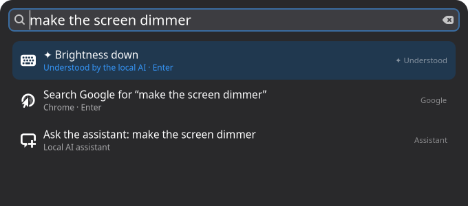</td>
<td>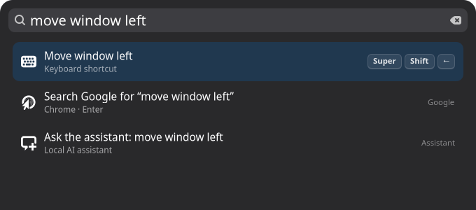</td>
<td>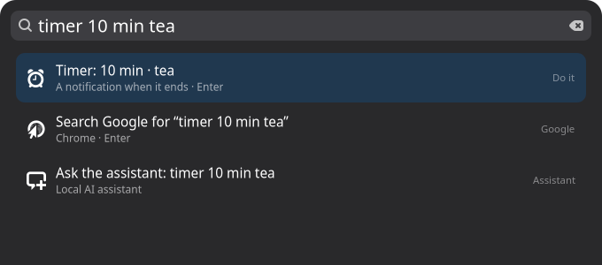</td>
</tr>
</table>

## The counter

<table>
<tr>
<td width="33%" valign="top">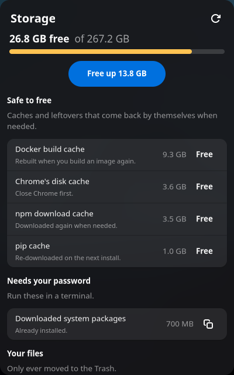<br><b>Storage</b><br>What's using your disk and what's safe to free. Caches in one click; your files only ever go to the Trash.</td>
<td width="33%" valign="top">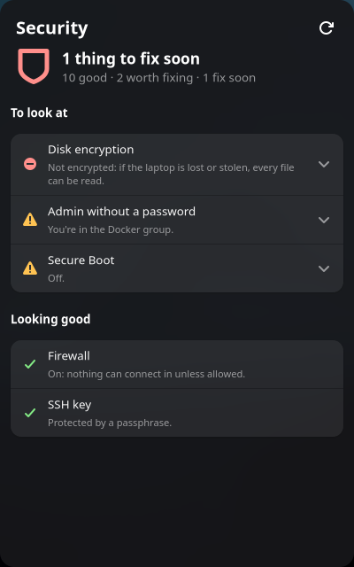<br><b>Security checkup</b><br>Firewall, open ports, disk encryption, updates, keys and logins in plain words, worst first, with the fix.</td>
<td width="33%" valign="top">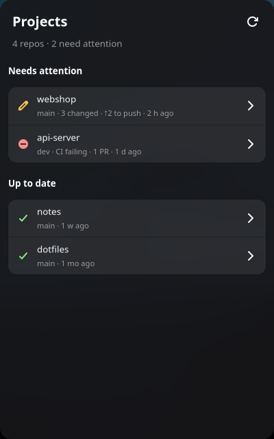<br><b>Projects</b><br>Every repo at a glance: uncommitted work, commits to push, failing CI, open PRs. Click to start coding.</td>
</tr>
<tr>
<td valign="top">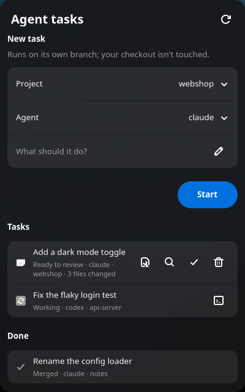<br><b>Agent tasks</b><br>Hand a task to Claude Code or Codex. It works on its own branch while you do something else; review, then merge.</td>
<td valign="top">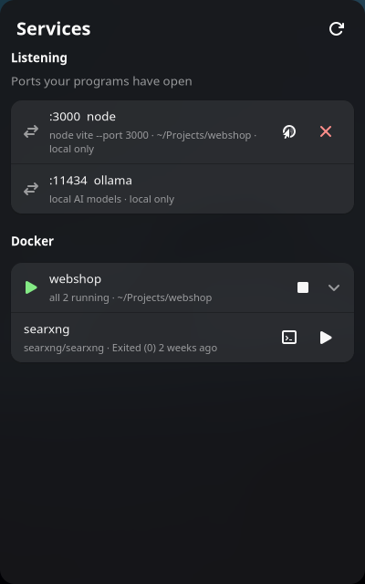<br><b>Services</b><br>Dev servers and the ports they hold, Docker containers by compose project: open, stop, start, follow logs.</td>
<td valign="top">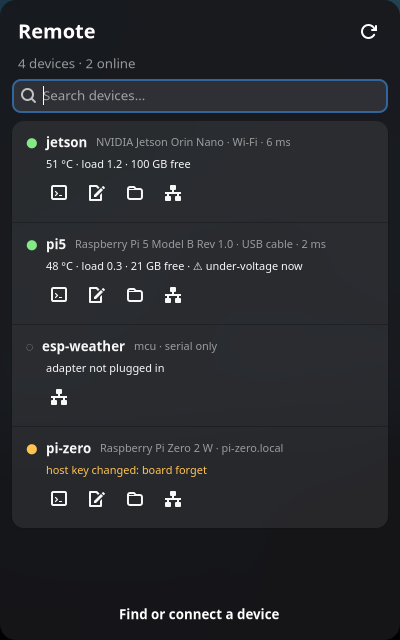<br><b>Remote devices</b><br>Raspberry Pis and boards over SSH: health, terminal, VS Code, files, serial console, who's on the network.</td>
</tr>
<tr>
<td valign="top">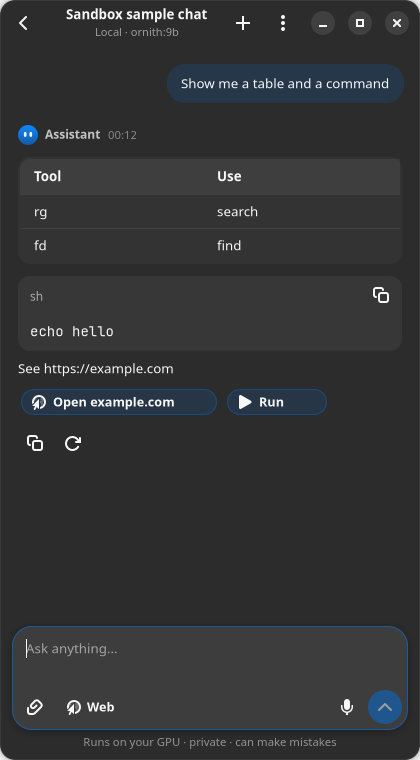<br><b>The assistant</b><br>A local model that can read your screen, search your files, check the laptop and ask before it acts.</td>
<td valign="top">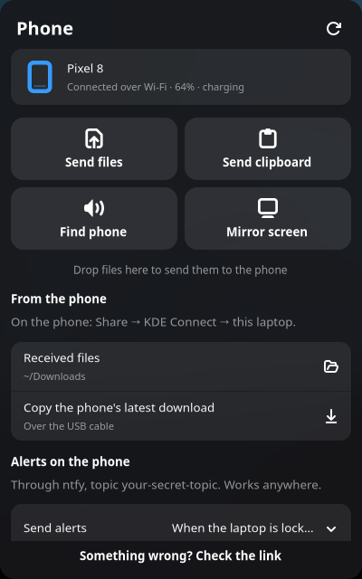<br><b>Phone link</b><br>Files and links both ways, clipboard, ring your phone, mirror it, and alerts that reach you anywhere.</td>
<td valign="top">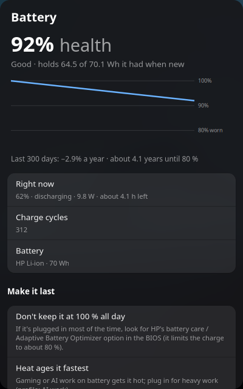<br><b>Battery health</b><br>How your battery is ageing, with a daily history, a projection and what actually makes it last.</td>
</tr>
</table>

<details>
<summary><b>Everything else in the kitchen</b></summary>

**Desktop**: Hyprland with a calm Graphite theme · auto-hiding bar with live status · native GTK4 panels (Wi-Fi, Bluetooth,
clipboard history, calendar, "what needs me" inbox) · screen recording with a bar timer · screenshots with annotation ·
work profiles (AI work, battery saver, presenting) · external monitor layouts remembered per set of displays ·
the KadaOS mark on the bar, lock screen and (if you like) the boot and login screens · water-break reminders that count real screen time · a "while you were away" summary · Downloads tidy rules (off until you
turn them on).

**Development**: `new-project` makes folders that load their own tools, `.env` and virtualenv when you `cd` in (direnv,
mise, uv) · `job` runs heavy builds in a memory box so the desktop never freezes · Docker with a services view ·
work layouts ("chrome and two terminals" tiles on an empty workspace).

**Agents**: Claude Code, Codex and Antigravity side by side in tmux sessions · the agent task board (worktree per task) ·
`agent-review` asks a *different* agent for a second opinion · repos made "multi-agent ready" with shared rules and handoffs.

**Security**: firewall, AppArmor, unattended upgrades, fail2ban · `secret-scan` before every commit (gitleaks) · KeePassXC ·
network trust levels (random MAC, encrypted DNS, no incoming connections on public Wi-Fi) · USB guard against BadUSB ·
`seclab` engagements with an enforced scope, recipes, findings and a PDF report · Wi-Fi adapter detection · CTF workspaces ·
an isolated VM network for lab targets.

**AI, all on your machine** (Ollama): the assistant · AI on selected text · dictation in any app · OCR (English + Malayalam) ·
search your files by meaning · a private metasearch engine for web answers · the launcher's plain-language understanding.

**Embedded and robotics**: `board` for SSH devices (setup, keys, health, mount, push/pull, background jobs, alerts) ·
serial console · ROS 2 Lyrical natively plus an isolated Space ROS image.

**Phone** (Android): KDE Connect on Wi-Fi, the USB cable as a fallback, ntfy for alerts anywhere.

</details>

## Before you order

- **Ubuntu 24.04 to 26.04**, x86-64, with **15 GB** free (the Full Sadhya with AI models wants about 25 GB).
- Built and tested on an HP OMEN 16 (Intel + RTX 5050, 16 GB RAM). Other laptops and desktops work; hardware-specific parts
  (hybrid graphics, panel refresh rates, battery care, NVIDIA encoding) are detected and skipped when they don't apply.
- The local AI is happiest with an NVIDIA GPU (8 GB) or a fast CPU and 16 GB of RAM. Everything else runs on modest machines.
- GNOME stays installed as a fallback session: pick it at the login screen any time.

## Make it yours

KadaOS is one person's workflow, written so you can change it. [Adapting KadaOS](docs/ADAPTING.md) covers the usual edits:
your colours, your shortcuts, your apps in the launcher, the assistant's model, what runs at login, and how to turn
any feature off. The theme is generated from one palette in [`scripts/theme.py`](scripts/theme.py); every dotfile is in
[`config/`](config).

`bash scripts/desktop-check.sh` tells you if the desktop matches the repo; `bash tests/run-all.sh` runs 1,100+ checks of
every script, app and screen (off-screen, safe while you work). See [Testing](docs/TESTING.md).

## FAQ

<details><summary><b>Will it mess up my current setup?</b></summary>

Configs it replaces are backed up first (`~/.config/setup-backups/<time>/`), GNOME stays as a login option, and every script
is idempotent. Start with **Chaya** if you want to try the desktop before ordering more.
</details>

<details><summary><b>Does anything get sent to the cloud?</b></summary>

No. The assistant, dictation, OCR, file search and the launcher's understanding use local models through Ollama. Coding
agents (Claude Code, Codex) talk to their providers only when you use them, with your own accounts.
</details>

<details><summary><b>How do I undo a feature?</b></summary>

Each guide ends with its undo, and most features have an off switch in Super + Space. For the system-level ones:
[Network trust](docs/NETWORK_TRUST.md), [USB guard](docs/USB_GUARD.md), [Secrets](docs/SECRETS.md).
</details>

<details><summary><b>Why "Kada"?</b></summary>

Because a good thattukada has everything you need, nothing you don't, and it's open when you are.
</details>

## Contributing and security

It's a personal setup first, so changes that make it more adaptable are the most welcome: see
[CONTRIBUTING.md](CONTRIBUTING.md). Found a security problem? Please report it privately: [SECURITY.md](SECURITY.md).

<div align="center">
<br>
<sub>MIT licensed · Made in Kerala, served everywhere</sub>
</div>
